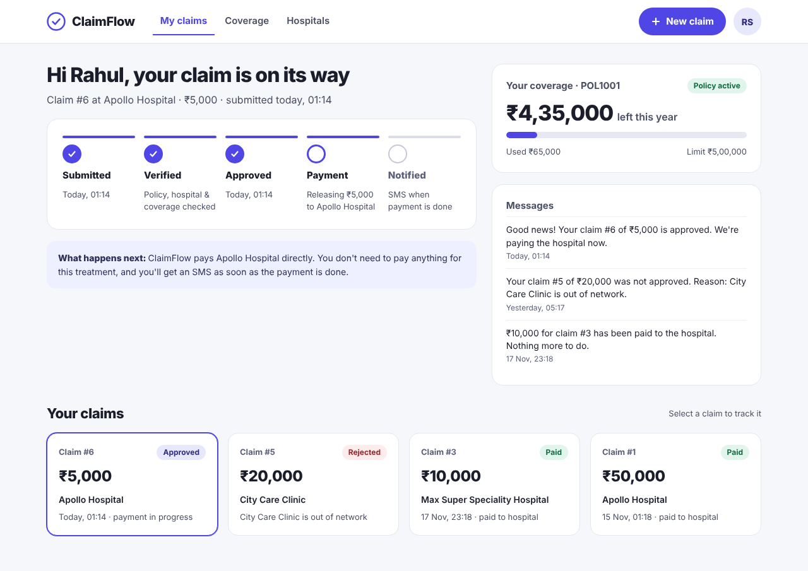
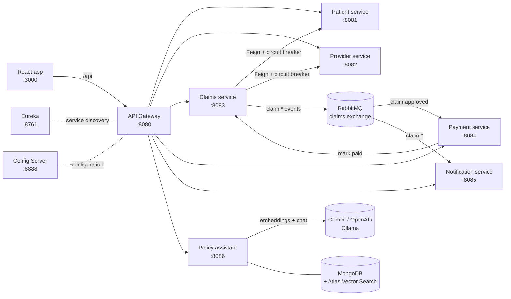
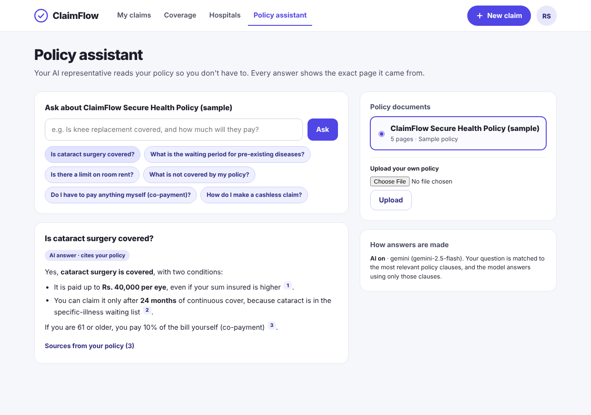
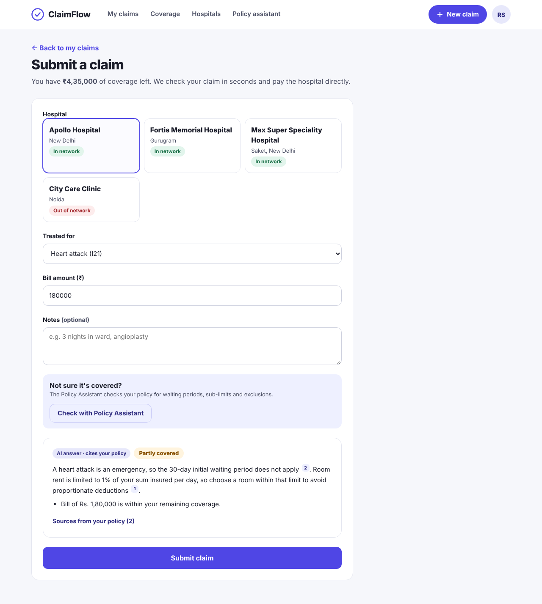
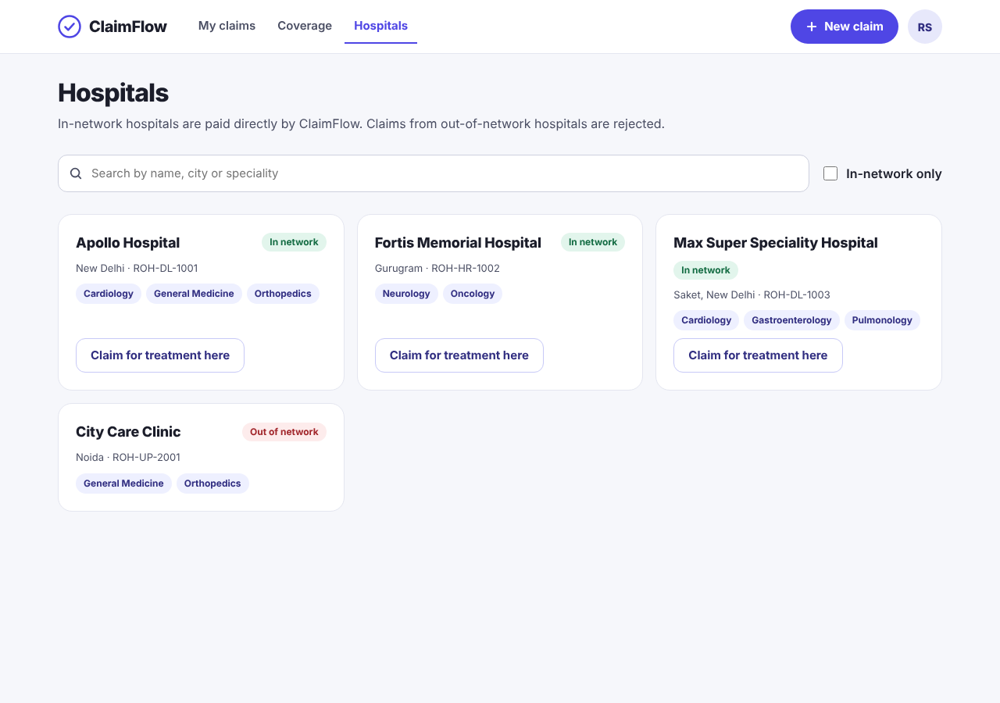

# ClaimFlow 🏥

**A health-insurance claims platform built with Spring Boot microservices and React.**

A patient submits a hospital bill (a *claim*). ClaimFlow checks it against the patient's policy, the hospital's network status and the remaining coverage, then approves or rejects it within seconds. Approved claims are paid to the hospital automatically, and the patient gets a notification at every step, which they can follow in a live tracker.

A built-in **AI Policy Assistant (RAG)** acts as the patient's representative: upload a policy PDF, ask anything about it in plain English, or pre-check a claim before submitting it. Every answer cites the exact page of the policy it came from.



---

## Features

- **Instant claim decisions** using three rules: active policy, in-network hospital, enough coverage left
- **Live claim tracker**: Submitted → Verified → Approved → Paid → Notified, updated as each service finishes its part
- **Event-driven payments and notifications** over RabbitMQ: the Claims service never waits for them
- **Safe under concurrency, without locks**: coverage is reserved with one atomic conditional MongoDB update (`findAndModify` with `$expr`), so parallel claims can never overspend a policy (tested with 40 claims fired at once)
- **Resilient**: if Patient or Provider service is down, the circuit breaker opens, the claim stays *SUBMITTED*, and a scheduled job re-checks it automatically when the service is back
- **Idempotent payments**: a claim is never paid twice, even if RabbitMQ delivers a message twice
- **AI Policy Assistant (RAG)**: policy PDFs are split into chunks, embedded and stored in **MongoDB**, searched with **Atlas Vector Search** (`$vectorSearch`); questions retrieve the closest clauses and a language model answers using only them, with page citations. Works with **Google Gemini (free key), OpenAI or local Ollama**, and still works with no AI key at all (search-only mode with a built-in local embedding)
- **Claim pre-check**: "Will this be covered?" before submitting, with a verdict (likely / partly / not covered) and the waiting periods, sub-limits and exclusions that apply
- **One command to run everything** with Docker Compose, plus demo data on first start

## Architecture



| Service | Port | Responsibility | Database |
|---|---|---|---|
| `eureka-server` | 8761 | Service registry: services find each other by name | none |
| `config-server` | 8888 | Central configuration for every service | none |
| `api-gateway` | 8080 | Single entry point; routes requests via Eureka with load balancing | none |
| `patient-service` | 8081 | Patients, policies, coverage limit and usage | `patient_db` |
| `provider-service` | 8082 | Hospitals, specialities, network status | `provider_db` |
| `claims-service` | 8083 | Verifies, approves/rejects claims, publishes events | `claims_db` |
| `payment-service` | 8084 | Pays approved claims, marks them PAID | `payment_db` |
| `notification-service` | 8085 | Sends (simulated) SMS for every status change | `notification_db` |
| `policy-assistant-service` | 8086 | RAG over policy documents: upload, ask, pre-check claims | `policy_db` (+ vector index) |
| `frontend` | 3000 | React patient portal (nginx) | none |

### How the Policy Assistant works (RAG)

1. **Indexing**: an uploaded PDF (read with Apache PDFBox) or text policy is split page by page into overlapping 160-word chunks. Each chunk gets two embeddings: the AI provider's embedding, and a local 512-dimension "hashing" embedding that needs no AI. Both are stored as arrays in MongoDB (`policy_chunks`), with an **Atlas Vector Search** index on each.
2. **Retrieval**: the question is embedded the same way, and the 5 closest chunks of that policy are found with `$vectorSearch` (cosine). If the cluster has no Atlas Search (plain MongoDB), or a policy was uploaded seconds ago and isn't indexed yet, exact cosine similarity is computed in Java instead, so the assistant always answers.
3. **Generation**: the chunks are numbered and sent to the chat model with strict rules: use only these excerpts, cite them as [1], [2], mention waiting periods, sub-limits, co-payments and exclusions, and say so when the policy doesn't answer the question.
4. **Fallbacks**: no AI key, or the provider is down → the assistant returns the best-matching clauses (search-only mode). Chunks uploaded while the AI was off get their AI embeddings later from a background job.

The LLM client is a small hand-written client for the OpenAI-compatible API (`/chat/completions`, `/embeddings`), so the same code works with Gemini, OpenAI and Ollama.

### What happens when a claim is submitted

1. `POST /claims` reaches the **Claims service** through the gateway.
2. Claims calls **Patient** and **Provider** services with **OpenFeign** (through a **Resilience4j circuit breaker**).
3. The rules run (`ClaimRules`, unit-tested): patient exists and policy active → hospital exists and in-network → amount ≤ remaining coverage.
4. On approval, Claims reserves the amount in Patient service: one atomic `findAndModify` that adds the amount only if `usedAmount + amount <= coverageLimit`, so it can never go negative.
5. Claims publishes `claim.approved` / `claim.rejected` to the `claims.exchange` topic exchange and returns immediately.
6. **Payment service** (bound to `claim.approved`) pays the hospital, then calls Claims to mark it **PAID**, which publishes `claim.paid`.
7. **Notification service** (bound to `claim.*`) sends the patient a message for every status change.

## Tech stack

**Backend:** Java 21 · Spring Boot 4 · Spring Cloud (Eureka, Config Server, Gateway, OpenFeign, LoadBalancer, CircuitBreaker/Resilience4j) · Spring Data MongoDB · MongoDB (database per service, Decimal128 money) · Atlas Vector Search · RabbitMQ (Spring AMQP) · Apache PDFBox · Lombok · JUnit 5
**AI:** Retrieval-Augmented Generation · Google Gemini / OpenAI / Ollama through the OpenAI-compatible API
**Frontend:** React 19 · React Router · Vite · plain CSS
**DevOps:** Docker · Docker Compose · nginx · multi-module Maven

---

## Run it (Docker: one command)

**Requirements:** Docker Desktop with about 4 GB of memory available.

```bash
git clone https://github.com/<your-username>/claimflow.git
cd claimflow
docker compose up --build
```

**Optional: turn on AI answers.** Copy `.env.example` to `.env` and paste a free Google Gemini key from https://aistudio.google.com/apikey (or choose OpenAI / Ollama in that file). Without it, the Policy Assistant runs in search-only mode.

The first build downloads Maven and npm packages and takes a few minutes. Services restart a couple of times while the Config Server comes up; that's expected. When it settles, open:

| What | URL |
|---|---|
| **The app** | http://localhost:3000 |
| API Gateway | http://localhost:9080/patients |
| Eureka dashboard | http://localhost:8761 |
| RabbitMQ dashboard | http://localhost:15672 (guest / guest) |

Stop with `docker compose down` (add `-v` to wipe the databases).

## Run it locally (for development)

1. **Infrastructure in Docker:**
   ```bash
   docker compose up -d mongodb rabbitmq
   ```
2. **Backend:** open the root folder in IntelliJ IDEA (it detects the multi-module Maven project) and run these main classes **in this order**:
   `EurekaServerApplication` → `ConfigServerApplication` → `PatientServiceApplication`, `ProviderServiceApplication`, `ClaimsServiceApplication`, `PaymentServiceApplication`, `NotificationServiceApplication`, `PolicyAssistantApplication` → `ApiGatewayApplication`
   From a terminal instead: run `mvn install -DskipTests` once in the root folder, then `mvn -pl services/patient-service spring-boot:run` (one terminal per service).
3. **Frontend:**
   ```bash
   cd frontend
   npm install
   npm run dev
   ```
   Open http://localhost:5173. Vite forwards `/api` calls to the gateway on :9080.

## Demo script (2 minutes)

The database is seeded on first start with **3 patients** (Rahul and Priya active; **Amit's policy is inactive**) and **4 hospitals** (**City Care Clinic is out of network**).

1. Open the app and choose **Rahul Sharma**.
2. **New claim** → Apollo Hospital → Heart attack (I21) → ₹50,000 → watch the tracker go *Approved → Payment → Paid → Notified*, and the coverage bar move.
3. New claim at **City Care Clinic** → rejected: *out of network*.
4. New claim for **₹9,00,000** → rejected: *coverage limit exceeded*.
5. Switch to **Amit Verma** and submit any claim → rejected: *policy is inactive*.
6. **Policy Assistant:** open *Policy assistant* and click "Is cataract surgery covered?". Then on *New claim*, pick a treatment and amount and click **Check with Policy Assistant**. Try uploading [`docs/sample-policy.pdf`](docs/sample-policy.pdf) or your own policy PDF.
7. **Async messaging:** `docker compose stop notification-service`, submit a claim (it's still approved instantly), see the message waiting in RabbitMQ's `notification.queue`, then `docker compose start notification-service` and watch it get delivered.
8. **Resilience:** `docker compose stop patient-service`, submit a claim → it stays *Checking* with "verification pending". Start the service again: within ~30 s the retry job approves it.

A Postman collection with every endpoint and rule is in [`docs/ClaimFlow.postman_collection.json`](docs/ClaimFlow.postman_collection.json).

## API (through the gateway, `http://localhost:9080`)

| Method | Path | Description |
|---|---|---|
| GET | `/patients` · `/patients/{id}` | Patients with `remainingCoverage` |
| POST | `/patients` | Create a patient (409 on duplicate email/policy) |
| GET | `/providers` · `/providers/{id}` | Hospitals |
| POST | `/providers` | Create a hospital (409 on duplicate registration number) |
| POST | `/claims` | Submit a claim `{patientId, providerId, diagnosisCode, amount, description?}` |
| GET | `/claims/{id}` · `/claims/patient/{patientId}` | Claims, newest first |
| GET | `/payments/claim/{claimId}` · `/payments/patient/{patientId}` | Payments |
| GET | `/notifications/patient/{patientId}` | Messages sent to a patient |
| GET | `/policies` · `/policies/{id}` | Policy documents |
| POST | `/policies` (multipart: `file`, `title?`, `policyNumber?`) | Upload and index a policy (PDF/TXT, up to 20 MB) |
| POST | `/policies/ask` | `{question, documentId?}` → answer + cited sources |
| POST | `/policies/precheck` | `{diagnosisCode, diagnosisLabel, amount, hospitalName, documentId?}` → verdict + sources |
| GET | `/policies/assistant/status` | Which AI provider/models are active |

Errors return JSON with a readable `message` (404 not found, 409 conflict, 400 validation).

## Project structure

```
claimflow/
├── pom.xml                         # parent POM (Spring Boot + Spring Cloud versions)
├── common/claimflow-events/        # shared RabbitMQ contract: ClaimEvent + exchange/queue names
├── services/
│   ├── eureka-server/
│   ├── config-server/              # src/main/resources/configs/*.yml = config for every service
│   ├── api-gateway/
│   ├── patient-service/
│   ├── provider-service/
│   ├── claims-service/             # rules, Feign clients, circuit breaker, retry job, tests
│   ├── payment-service/
│   ├── notification-service/
│   └── policy-assistant-service/   # RAG: PDF reading, chunking, vector search, LLM client
├── frontend/                       # React + Vite, served by nginx in Docker
├── docker-compose.yml
├── Dockerfile                      # builds any backend service (MODULE build arg)
└── docs/                           # Postman collection, sample policy PDF, screenshots
```

## Screenshots

| Rejected claim | New claim |
|---|---|
|  |  |

| Policy assistant | Claim pre-check |
|---|---|
|  |  |

| Coverage | Hospitals |
|---|---|
|  |  |

## Troubleshooting

- **`Could not find artifact org.springframework.cloud:spring-cloud-dependencies`**: the `<spring-cloud.version>` in the root `pom.xml` must match your Spring Boot version. Generate any project on [start.spring.io](https://start.spring.io) with Boot 4.1.x plus a Spring Cloud dependency and copy its `<spring-cloud.version>`.
- **Can't connect to MongoDB when running locally**: start it with `docker compose up -d mongodb`, or set `MONGODB_URI` (e.g. your Atlas connection string). Each service creates its own database (`patient_db`, `claims_db`, …) on first start.
- **Services keep restarting in Docker** for the first minute: they wait for the Config Server. Check `docker compose logs config-server`.
- **Policy Assistant logs "Atlas Vector Search not available"**: you're on plain MongoDB; search still works (in-app cosine). Use the `mongodb` service from docker-compose (MongoDB Atlas Local) or an Atlas cluster to get `$vectorSearch`.
- **Policy Assistant says "search-only mode" although you set a key**: check `docker compose logs policy-assistant-service | grep "Policy assistant AI"`. The `.env` file must be next to `docker-compose.yml`, and services must be recreated (`docker compose up -d`).
- **Eureka shows a red "self preservation" warning**: harmless in development; it's turned off in `eureka-server`'s config.

## Database design (MongoDB)

Each service owns its own database on one MongoDB cluster, and no service reads another's data (it calls that service's API instead).

| Database | Collections | Notes |
|---|---|---|
| `patient_db` | `patients` | unique indexes on `email`, `policyNumber`; money as Decimal128 |
| `provider_db` | `providers` | unique `registrationNumber`; specializations are an array inside the document |
| `claims_db` | `claims`, `counters` | `claimNumber` (CLM-2026-000123) from an atomic counter; index on `status + createdAt` for the retry job |
| `payment_db` | `payments` | unique index on `claimId`: a claim can never be paid twice |
| `notification_db` | `notifications` | one document per message |
| `policy_db` | `policy_documents`, `policy_chunks` | chunk vectors with Atlas Vector Search indexes |

Tests that need a database run against a real MongoDB when `MONGODB_TEST_URI` (and `ATLAS_LOCAL_TEST_URI` for vector search) are set, and are skipped otherwise:

```bash
docker run -d -p 27017:27017 mongodb/mongodb-atlas-local:8
MONGODB_TEST_URI="mongodb://localhost:27017/?directConnection=true" \
ATLAS_LOCAL_TEST_URI="mongodb://localhost:27017/?directConnection=true" mvn test
```

## Possible next steps

- Streaming answers (Server-Sent Events) and chat history in the Policy Assistant
- Spring Security with JWT, with separate patient and claims-officer roles
- A claims-officer dashboard for manual review of large claims
- Distributed tracing with Micrometer + Zipkin
- Deploy on AWS (ECS or EC2) with RDS and Amazon MQ
- GitHub Actions CI to build, test and push Docker images

## New: real emails, pop-up alerts, set up from your policy, chat while claiming

**Real emails.** notification-service emails the patient on every claim update (received → approved/rejected → paid).
1. Turn on 2-Step Verification on your Google account, then create an app password at https://myaccount.google.com/apppasswords
2. In `.env` set `MAIL_USERNAME=you@gmail.com`, `MAIL_PASSWORD=<16-letter app password>` and, for the demo patients, `NOTIFY_EMAIL_OVERRIDE=you@gmail.com`
3. `docker compose up -d --build notification-service`

Without `MAIL_USERNAME` email is off and messages stay in-app only. `@example.com` addresses are skipped.

**Pop-up alerts.** Every error shows a red pop-up; approvals/payments are green, warnings amber, info indigo.

**Set up from your policy.** On the welcome screen upload a policy PDF or photo (`POST /policies/extract-profile`). The AI fills in name, email, phone, policy number and sum insured; you check them and create the profile. PDFs are also added to the Policy Assistant. Try `docs/sample-policy-schedule.pdf`.

**Chat while claiming.** The claim page has an "Ask about this claim" chat beside the form, plus a "Check compliance" button.


## Free live demo (no servers)

The `frontend` can also be built as a **demo site** that runs entirely in the browser: `src/demo/demoServer.js`
answers the same API URLs as the gateway, with the same rules (ClaimRules, payment after a few seconds, messages),
and `src/demo/policyBrain.js` answers common policy questions from the sample policy with citations.
Data is saved in the visitor's browser (localStorage).

```bash
cd frontend
npm run build:demo        # uses .env.demo (VITE_DEMO=true)
npm run preview:demo      # try it on http://localhost:4173
```

Deploy for free on Render: push the repo to GitHub, then Render → **New → Blueprint** → pick the repo.
`render.yaml` builds the demo as a static site (no credit card needed).
