# ClaimFlow 🏥

**A health-insurance claims platform built with Spring Boot microservices and React.**

A policyholder submits a hospital bill (a *claim*), or the hospital raises a **cashless** claim directly. ClaimFlow checks it against the policy, the hospital's network status and the remaining coverage, then runs an explainable **fraud check**. Clean claims are approved within seconds; unusual ones go to a **claims officer**, who sees every red flag plus an **AI (Gemini) summary** and approves, rejects or asks for more information. Approved claims are paid to the hospital automatically, and the policyholder gets an email (with a copy to their alternate email) at every step.

Four roles sign in with their own accounts: **Policyholder · Hospital · Claims officer · Admin**.

A built-in **AI Policy Assistant (RAG)** acts as the patient's representative: upload a policy PDF, ask anything about it in plain English, or pre-check a claim before submitting it. Every answer cites the exact page of the policy it came from.


---

## Features

- **Sign-in with 4 roles** (auth-service): JWT (HS256) issued at login, checked once at the API Gateway, which allows each route only for certain roles and checks that a policyholder/hospital only reaches its own data; BCrypt passwords, forgot/reset password by email, admins create staff accounts and can switch accounts off
- **Instant claim decisions** using three rules: active policy, in-network hospital, enough coverage left
- **Explainable fraud scoring** (`FraudRules`, unit-tested): early claim after the policy starts, bill far above the usual cost for the treatment, possible duplicate, overlapping hospital stays, many recent claims, most of the cover in one go, high cost per day, late filing, round amounts. Each flag adds points and says why; LOW risk is decided automatically, MEDIUM/HIGH go to the officer's queue (riskiest first)
- **Officer review**: approve / reject / ask for information / internal notes; the policyholder or hospital replies in the app; a review lock (atomic `findAndModify`) stops two officers approving the same claim twice
- **AI fraud summary**: Gemini explains a flagged claim to the officer in 2-3 sentences with a suggestion (advice only); without an AI key a summary is built from the flags
- **Cashless claims**: the hospital looks the patient up by policy number and claims the bill directly
- **Live claim tracker**: Submitted → Verified → Approved → Paid → Notified, updated as each service finishes its part
- **Event-driven payments and notifications** over RabbitMQ: the Claims service never waits for them
- **Safe under concurrency, without locks**: coverage is reserved with one atomic conditional MongoDB update (`findAndModify` with `$expr`), so parallel claims can never overspend a policy (tested with 40 claims fired at once)
- **Resilient**: if Patient or Provider service is down, the circuit breaker opens, the claim stays *SUBMITTED*, and a scheduled job re-checks it automatically when the service is back
- **Idempotent payments**: a claim is never paid twice, even if RabbitMQ delivers a message twice
- **AI Policy Assistant (RAG)**: policy PDFs are split into chunks, embedded and stored in **MongoDB**, searched with **Atlas Vector Search** (`$vectorSearch`); questions retrieve the closest clauses and a language model answers using only them, with page citations. Works with **Google Gemini (free key), OpenAI or local Ollama**, and still works with no AI key at all (search-only mode with a built-in local embedding)
- **Claim pre-check**: "Will this be covered?" before submitting, with a verdict (likely / partly / not covered) and the waiting periods, sub-limits and exclusions that apply
- **Emails through Brevo's HTTP API** (or SMTP): claim updates, welcome, password reset; every email also goes to the account's alternate email
- **One command to run everything** with Docker Compose, plus demo data on first start

## Architecture

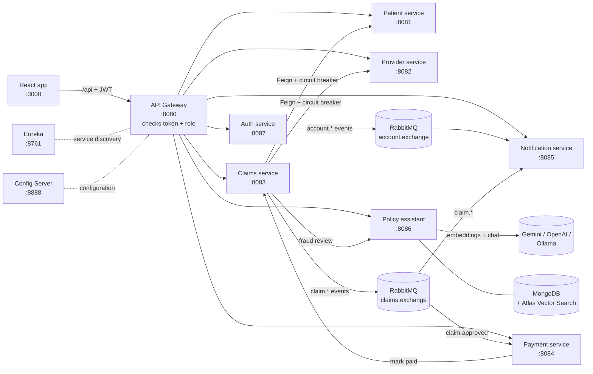

| Service | Port | Responsibility | Database |
|---|---|---|---|
| `eureka-server` | 8761 | Service registry: services find each other by name | none |
| `config-server` | 8888 | Central configuration for every service | none |
| `api-gateway` | 8080 | Single entry point; checks the login token and role, then routes via Eureka with load balancing | none |
| `auth-service` | 8087 | Accounts, login (JWT), roles, password reset, staff accounts | `auth_db` |
| `patient-service` | 8081 | Patients, policies, coverage limit and usage | `patient_db` |
| `provider-service` | 8082 | Hospitals, specialities, network status | `provider_db` |
| `claims-service` | 8083 | Verifies claims, fraud check, officer review, publishes events | `claims_db` |
| `payment-service` | 8084 | Pays approved claims, marks them PAID | `payment_db` |
| `notification-service` | 8085 | In-app messages + emails (Brevo/SMTP) for every claim and account event | `notification_db` |
| `policy-assistant-service` | 8086 | RAG over policy documents: upload, ask, pre-check claims; AI fraud summaries | `policy_db` (+ vector index) |
| `frontend` | 3000 | React app for all 4 roles (nginx) | none |

### How the Policy Assistant works (RAG)

1. **Indexing**: an uploaded PDF (read with Apache PDFBox) or text policy is split page by page into overlapping 160-word chunks. Each chunk gets two embeddings: the AI provider's embedding, and a local 512-dimension "hashing" embedding that needs no AI. Both are stored as arrays in MongoDB (`policy_chunks`), with an **Atlas Vector Search** index on each.
2. **Retrieval**: the question is embedded the same way, and the 5 closest chunks of that policy are found with `$vectorSearch` (cosine). If the cluster has no Atlas Search (plain MongoDB), or a policy was uploaded seconds ago and isn't indexed yet, exact cosine similarity is computed in Java instead, so the assistant always answers.
3. **Generation**: the chunks are numbered and sent to the chat model with strict rules: use only these excerpts, cite them as [1], [2], mention waiting periods, sub-limits, co-payments and exclusions, and say so when the policy doesn't answer the question.
4. **Fallbacks**: no AI key, or the provider is down → the assistant returns the best-matching clauses (search-only mode). Chunks uploaded while the AI was off get their AI embeddings later from a background job.

The LLM client is a small hand-written client for the OpenAI-compatible API (`/chat/completions`, `/embeddings`), so the same code works with Gemini, OpenAI and Ollama.

### What happens when a claim is submitted

1. `POST /claims` reaches the **Claims service** through the gateway, which has already checked the login token and passes the user in `X-User-*` headers. A policyholder can only claim on their own policy, a hospital only for itself (cashless).
2. Claims calls **Patient** and **Provider** services with **OpenFeign** (through a **Resilience4j circuit breaker**).
3. The rules run (`ClaimRules`, unit-tested): patient exists and policy active → hospital exists and in-network → amount ≤ remaining coverage.
4. The **fraud check** (`FraudRules`) scores the claim using the policy and the policyholder's claims from the last 90 days. MEDIUM/HIGH → status *UNDER_REVIEW*, and policy-assistant asks Gemini for a summary in the background. LOW → step 5.
5. On approval (automatic, or by an officer), Claims reserves the amount in Patient service: one atomic `findAndModify` that adds the amount only if `usedAmount + amount <= coverageLimit`, so it can never go negative.
6. Claims publishes `claim.approved` / `claim.rejected` / `claim.under_review` / `claim.info_requested` to the `claims.exchange` topic exchange and returns immediately.
7. **Payment service** (bound to `claim.approved`) pays the hospital, then calls Claims to mark it **PAID**, which publishes `claim.paid`.
8. **Notification service** (bound to `claim.*` and `account.*`) saves an in-app message and emails the policyholder (login email + alternate email).

## Tech stack

**Backend:** Java 21 · Spring Boot 4 · Spring Cloud (Eureka, Config Server, Gateway, OpenFeign, LoadBalancer, CircuitBreaker/Resilience4j) · Spring Data MongoDB · MongoDB (database per service, Decimal128 money) · Atlas Vector Search · RabbitMQ (Spring AMQP) · Apache PDFBox · Lombok · JUnit 5
**AI:** Retrieval-Augmented Generation · Google Gemini / OpenAI / Ollama through the OpenAI-compatible API
**Frontend:** React 19 · React Router · Vite · plain CSS
**DevOps:** Docker · Docker Compose · nginx · multi-module Maven

---

## Run it (Docker: one command)

**Requirements:** Docker Desktop with about 4 GB of memory available.

```bash
git clone https://github.com/<your-username>/claimflow.git
cd claimflow
docker compose up --build
```

**Optional: turn on AI and email.** Copy `.env.example` to `.env`: paste a free Google Gemini key from https://aistudio.google.com/apikey (Policy Assistant answers and fraud summaries) and a Brevo API key (emails), and set your own `JWT_SECRET`. Without them, the assistant runs in search-only mode, fraud summaries are built from the rules, and messages stay in the app.

The first build downloads Maven and npm packages and takes a few minutes. Services restart a couple of times while the Config Server comes up; that's expected. When it settles, open:

| What | URL |
|---|---|
| **The app** | http://localhost:3000 |
| API Gateway | http://localhost:9080/patients |
| Eureka dashboard | http://localhost:8761 |
| RabbitMQ dashboard | http://localhost:15672 (guest / guest) |

Stop with `docker compose down` (add `-v` to wipe the databases).

## Run it locally (for development)

1. **Infrastructure in Docker:**
   ```bash
   docker compose up -d mongodb rabbitmq
   ```
2. **Backend:** open the root folder in IntelliJ IDEA (it detects the multi-module Maven project) and run these main classes **in this order**:
   `EurekaServerApplication` → `ConfigServerApplication` → `AuthServiceApplication`, `PatientServiceApplication`, `ProviderServiceApplication`, `ClaimsServiceApplication`, `PaymentServiceApplication`, `NotificationServiceApplication`, `PolicyAssistantApplication` → `ApiGatewayApplication`
   From a terminal instead: run `mvn install -DskipTests` once in the root folder, then `mvn -pl services/patient-service spring-boot:run` (one terminal per service).
3. **Frontend:**
   ```bash
   cd frontend
   npm install
   npm run dev
   ```
   Open http://localhost:5173. Vite forwards `/api` calls to the gateway on :9080.

## Demo script (2 minutes)

The database is seeded on first start with **3 policies** (Rahul; **Priya, whose policy started 20 days ago**; **Amit, inactive**), **4 hospitals** (**City Care Clinic is out of network**) and these accounts, all with password `password123` (one-click buttons on the sign-in page):

| Role | Email |
|---|---|
| Policyholder | `rahul@claimflow.dev`, `priya@claimflow.dev`, `amit@claimflow.dev` |
| Hospital | `apollo@claimflow.dev` (Apollo), `max@claimflow.dev` (Max) |
| Claims officer | `officer@claimflow.dev` |
| Admin | `admin@claimflow.dev` |

1. Sign in as **Rahul** (Policyholder).
2. **New claim** → Apollo Hospital → Heart attack (I21) → ₹50,000 → watch the tracker go *Approved → Payment → Paid → Notified*, and the coverage bar move.
3. New claim at **City Care Clinic** → rejected: *out of network*.
4. New claim for **₹9,00,000** → rejected: *coverage limit exceeded*.
5. Sign in as **Amit** and submit any claim → rejected: *policy is inactive*.
6. **Fraud review:** sign in as **Priya** and claim ₹1,18,000 for appendicitis → *In review* (claim 12 days after the policy started). Sign in as **Apollo Hospital**, *Cashless claim* → POL1001 → Cataract, ₹2,00,000 → *In review* (5× the usual cost). Sign in as the **Claims officer**: both are in the queue with their red flags and AI summary. Ask for information on one (the policyholder replies from their claim page), approve the other and watch it get paid.
7. Sign in as **Admin**: dashboard, people (create a staff account, switch one off), policies, add a hospital.
8. **Policy Assistant:** open *Policy assistant* and click "Is cataract surgery covered?". Then on *New claim*, pick a treatment and amount and click **Check with Policy Assistant**. Try uploading [`docs/sample-policy.pdf`](docs/sample-policy.pdf) or your own policy PDF.
9. **Async messaging:** `docker compose stop notification-service`, submit a claim (it's still approved instantly), see the message waiting in RabbitMQ's `notification.queue`, then `docker compose start notification-service` and watch it get delivered.
10. **Resilience:** `docker compose stop patient-service`, submit a claim → it stays *Checking* with "verification pending". Start the service again: within ~30 s the retry job approves it.

A Postman collection is in [`docs/ClaimFlow.postman_collection.json`](docs/ClaimFlow.postman_collection.json). Call `POST /auth/login` first and use the returned token as a Bearer token.

## API (through the gateway, `http://localhost:9080`)

Everything except the four public `/auth` routes needs `Authorization: Bearer <token>` from `POST /auth/login`.

| Method | Path | Description |
|---|---|---|
| POST | `/auth/login` · `/auth/register` | `{email, password}` → `{token, user}`; register links a policy by number or creates one |
| POST | `/auth/forgot-password` · `/auth/reset-password` | Reset link by email (30 minutes, single use) |
| GET/PATCH | `/auth/me` · POST `/auth/me/password` | Own account: name, alternate email, password |
| GET/POST | `/auth/users` · PATCH `/auth/users/{id}/active` | Admin: accounts, create staff, switch off |
| GET | `/patients` · `/patients/{id}` | Patients with `remainingCoverage` |
| POST | `/patients` | Create a patient (409 on duplicate email/policy) |
| GET | `/providers` · `/providers/{id}` | Hospitals |
| POST | `/providers` | Create a hospital (409 on duplicate registration number) |
| POST | `/claims` | Submit a claim `{patientId, providerId, diagnosisCode, treatment?, amount, admissionDate?, dischargeDate?, description?}` |
| GET | `/claims/{id}` · `/claims/patient/{patientId}` · `/claims/provider/{providerId}` | Claims, newest first (fraud details for staff only) |
| GET | `/claims/review-queue` · `/claims/stats` | Staff: flagged claims (riskiest first), dashboard numbers |
| POST | `/claims/{id}/review` | Staff: `{action: APPROVE / REJECT / REQUEST_INFO / NOTE, note}` |
| POST | `/claims/{id}/info` | Policyholder/hospital: reply to a request for information |
| GET | `/payments/claim/{claimId}` · `/payments/patient/{patientId}` | Payments |
| GET | `/notifications/patient/{patientId}` | Messages sent to a patient |
| GET | `/policies` · `/policies/{id}` | Policy documents |
| POST | `/policies` (multipart: `file`, `title?`, `policyNumber?`) | Upload and index a policy (PDF/TXT, up to 20 MB) |
| POST | `/policies/ask` | `{question, documentId?}` → answer + cited sources |
| POST | `/policies/precheck` | `{diagnosisCode, diagnosisLabel, amount, hospitalName, documentId?}` → verdict + sources |
| GET | `/policies/assistant/status` | Which AI provider/models are active |

Errors return JSON with a readable `message` (401 not signed in, 403 not allowed, 404 not found, 409 conflict, 400 validation).

## Project structure

```
claimflow/
├── pom.xml                         # parent POM (Spring Boot + Spring Cloud versions)
├── common/claimflow-events/        # shared RabbitMQ contract (ClaimEvent, AccountEvent) + JWT codec and roles
├── services/
│   ├── eureka-server/
│   ├── config-server/              # src/main/resources/configs/*.yml = config for every service
│   ├── api-gateway/                # JWT check + AccessRules (which role may call which route)
│   ├── auth-service/               # accounts, login, password reset, staff accounts
│   ├── patient-service/
│   ├── provider-service/
│   ├── claims-service/             # ClaimRules, FraudRules, officer review, Feign, circuit breaker, retry job
│   ├── payment-service/
│   ├── notification-service/
│   └── policy-assistant-service/   # RAG: PDF reading, chunking, vector search, LLM client
├── frontend/                       # React + Vite, served by nginx in Docker
├── docker-compose.yml
├── Dockerfile                      # builds any backend service (MODULE build arg)
└── docs/                           # Postman collection, sample policy PDF, screenshots
```

## Screenshots

| Sign in (one-click demo accounts) | Review queue (riskiest first) |
|---|---|
| 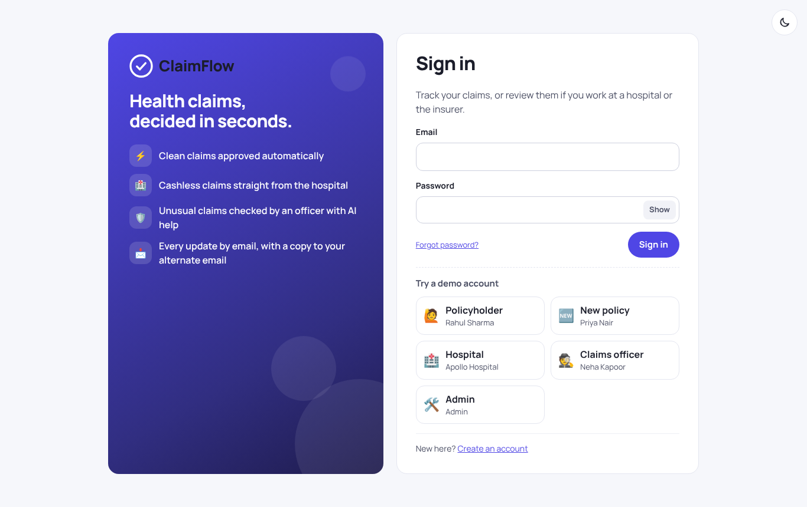 | 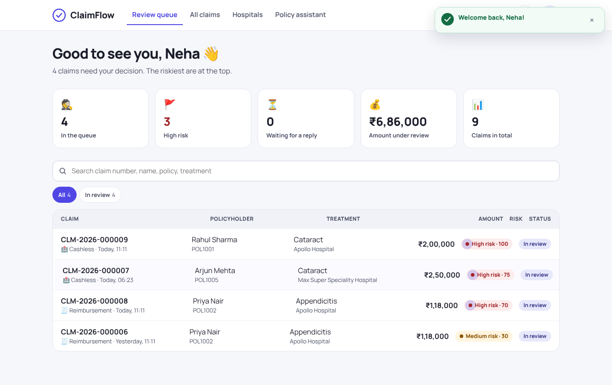 |

| Officer review: red flags + AI summary | Admin dashboard |
|---|---|
| 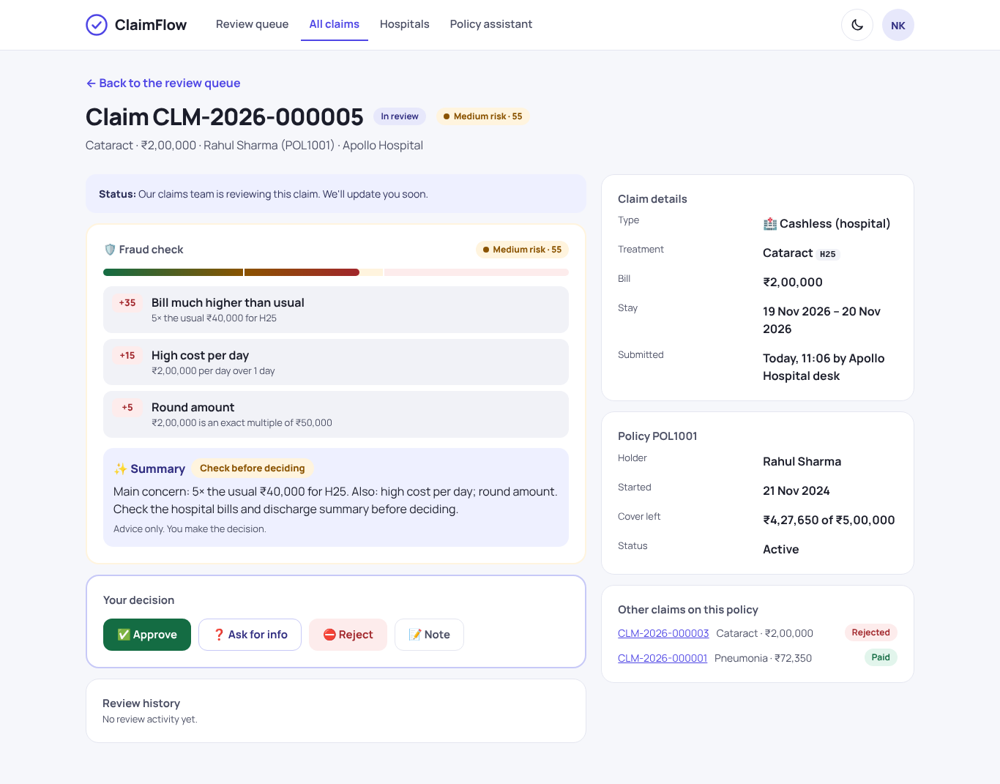 | 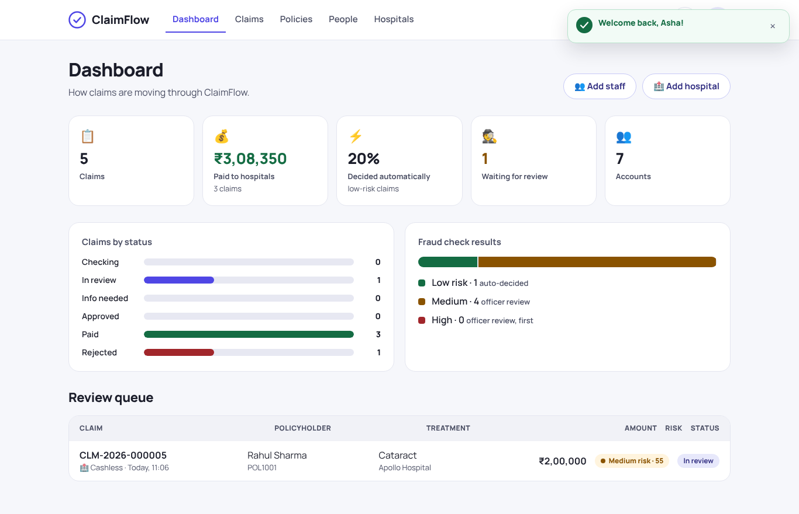 |

| Hospital: cashless claim | Policyholder: information needed |
|---|---|
| 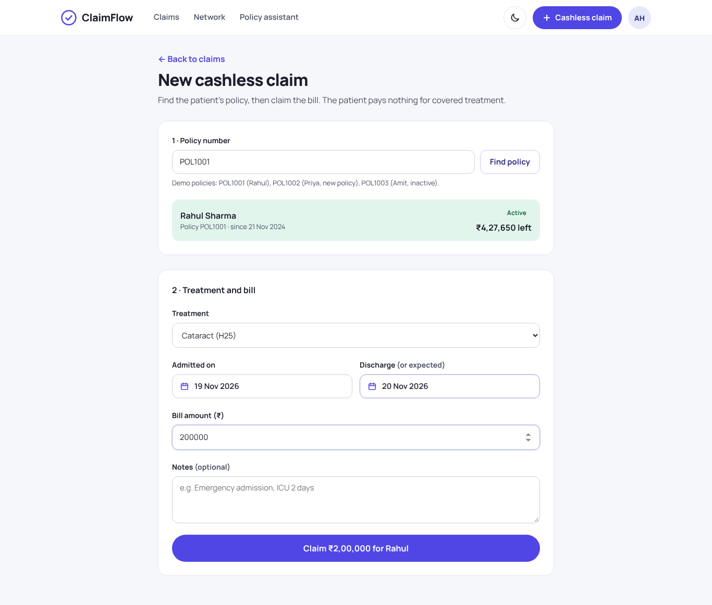 | 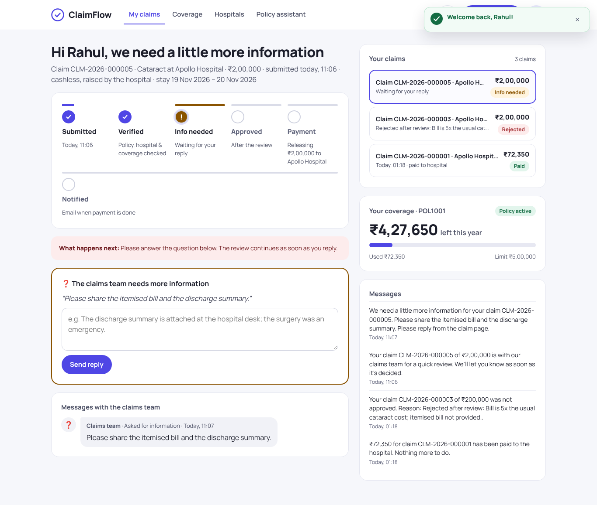 |

| Phone: claim review | Phone: date picker |
|---|---|
| 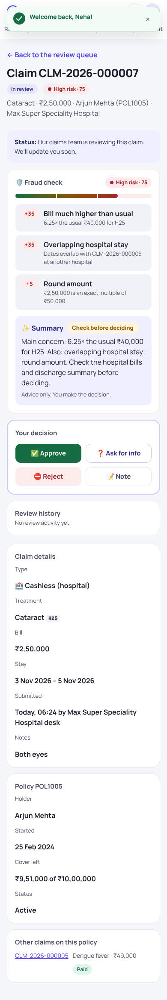 | 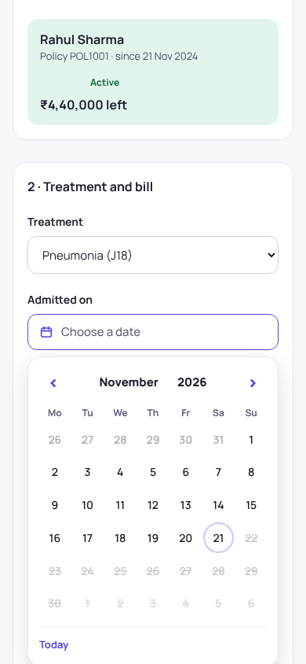 |

| Rejected claim | New claim |
|---|---|
| 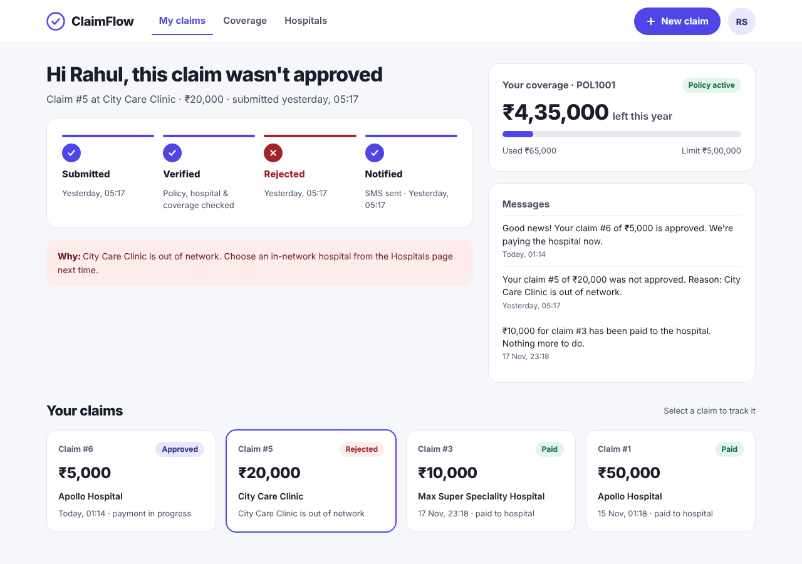 | 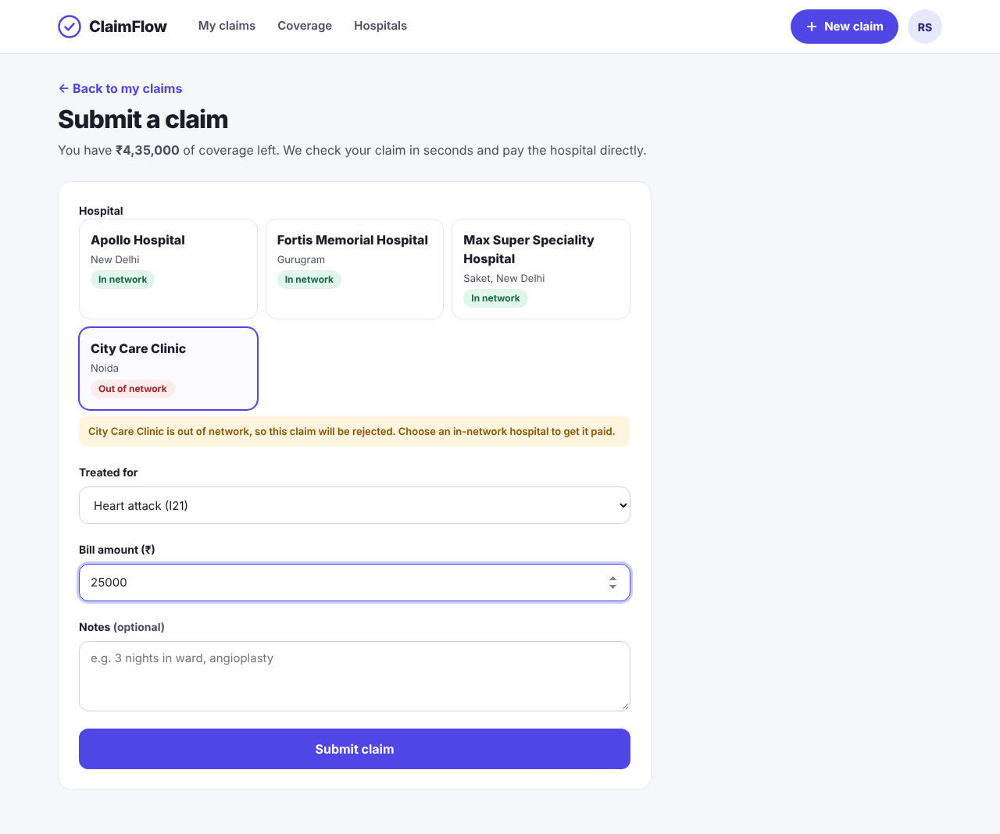 |

| Policy assistant | Claim pre-check |
|---|---|
|  |  |

| Coverage | Hospitals |
|---|---|
| 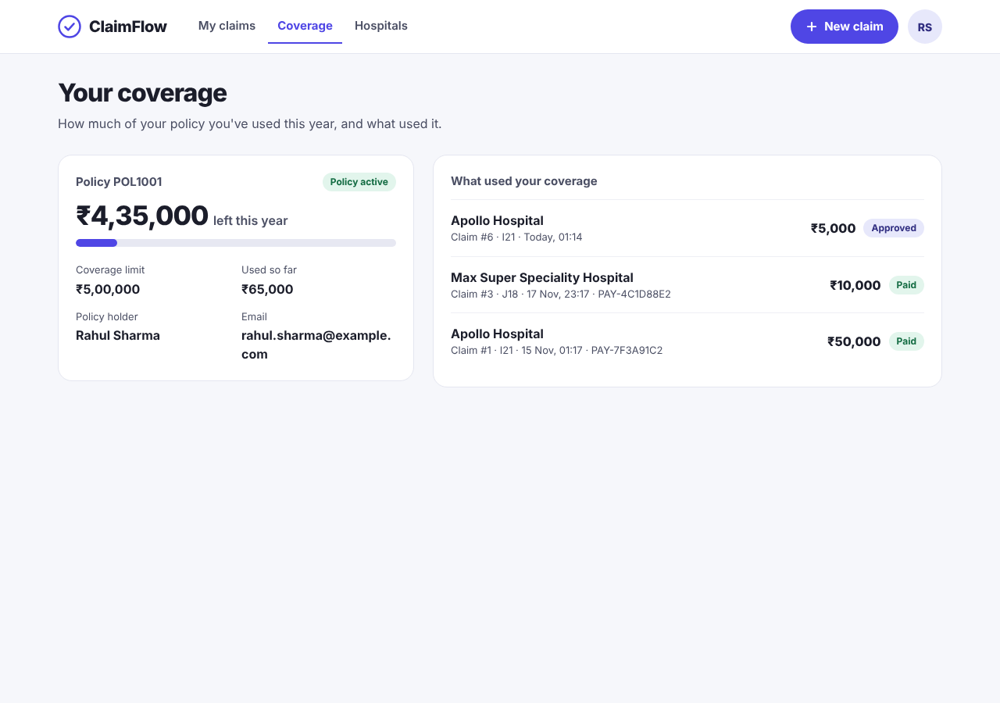 |  |

## Troubleshooting

- **`Could not find artifact org.springframework.cloud:spring-cloud-dependencies`**: the `<spring-cloud.version>` in the root `pom.xml` must match your Spring Boot version. Generate any project on [start.spring.io](https://start.spring.io) with Boot 4.1.x plus a Spring Cloud dependency and copy its `<spring-cloud.version>`.
- **Can't connect to MongoDB when running locally**: start it with `docker compose up -d mongodb`, or set `MONGODB_URI` (e.g. your Atlas connection string). Each service creates its own database (`patient_db`, `claims_db`, …) on first start.
- **Services keep restarting in Docker** for the first minute: they wait for the Config Server. Check `docker compose logs config-server`.
- **Policy Assistant logs "Atlas Vector Search not available"**: you're on plain MongoDB; search still works (in-app cosine). Use the `mongodb` service from docker-compose (MongoDB Atlas Local) or an Atlas cluster to get `$vectorSearch`.
- **Policy Assistant says "search-only mode" although you set a key**: check `docker compose logs policy-assistant-service | grep "Policy assistant AI"`. The `.env` file must be next to `docker-compose.yml`, and services must be recreated (`docker compose up -d`).
- **Eureka shows a red "self preservation" warning**: harmless in development; it's turned off in `eureka-server`'s config.

## Database design (MongoDB)

Each service owns its own database on one MongoDB cluster, and no service reads another's data (it calls that service's API instead).

| Database | Collections | Notes |
|---|---|---|
| `auth_db` | `users` | unique `email`; BCrypt password hash; reset tokens stored only as SHA-256 hashes |
| `patient_db` | `patients` | unique indexes on `email`, `policyNumber`; money as Decimal128 |
| `provider_db` | `providers` | unique `registrationNumber`; specializations are an array inside the document |
| `claims_db` | `claims`, `counters` | `claimNumber` (CLM-2026-000123) from an atomic counter; the fraud result and review history are stored inside the claim; indexes on `status + createdAt` (retry job, review queue) and `providerId + createdAt` |
| `payment_db` | `payments` | unique index on `claimId`: a claim can never be paid twice |
| `notification_db` | `notifications` | one document per message |
| `policy_db` | `policy_documents`, `policy_chunks` | chunk vectors with Atlas Vector Search indexes |

Tests that need a database run against a real MongoDB when `MONGODB_TEST_URI` (and `ATLAS_LOCAL_TEST_URI` for vector search) are set, and are skipped otherwise:

```bash
docker run -d -p 27017:27017 mongodb/mongodb-atlas-local:8
MONGODB_TEST_URI="mongodb://localhost:27017/?directConnection=true" \
ATLAS_LOCAL_TEST_URI="mongodb://localhost:27017/?directConnection=true" mvn test
```

## Possible next steps

- Streaming answers (Server-Sent Events) and chat history in the Policy Assistant
- Document uploads (bills, discharge summaries) attached to a claim
- Refresh tokens and sign-out from all devices
- Distributed tracing with Micrometer + Zipkin
- Deploy on AWS (ECS or EC2) with RDS and Amazon MQ
- GitHub Actions CI to build, test and push Docker images

## New: real emails, pop-up alerts, set up from your policy, chat while claiming

**Real emails.** notification-service emails the policyholder on every claim update (received → in review / information needed → approved/rejected → paid) and sends account emails (welcome, password reset, password changed). Each goes to the login email and the alternate email.
1. Brevo (recommended): create a free account, verify a sender, create an API key; in `.env` set `BREVO_API_KEY` and `MAIL_FROM`. Or SMTP: `MAIL_USERNAME` + `MAIL_PASSWORD` (Gmail app password).
2. For the demo accounts (`@claimflow.dev`, never emailed) set `NOTIFY_EMAIL_OVERRIDE=you@gmail.com` to receive everything yourself.
3. `docker compose up -d --build notification-service`

**Pop-up alerts.** Every error shows a red pop-up; approvals/payments are green, warnings amber, info indigo.

**Chat while claiming.** The claim page has an "Ask about this claim" chat beside the form, plus a "Check compliance" button.


## Free live demo (no servers)

The `frontend` can also be built as a **demo site** that runs entirely in the browser: `src/demo/demoServer.js`
answers the same API URLs as the gateway, with the same rules (accounts and roles, ClaimRules, FraudRules in `src/demo/fraudRules.js`, officer review, payment after a few seconds, messages),
and `src/demo/policyBrain.js` answers common policy questions from the sample policy with citations.
Data is saved in the visitor's browser (localStorage).

```bash
cd frontend
npm run build:demo        # uses .env.demo (VITE_DEMO=true)
npm run preview:demo      # try it on http://localhost:4173
```

Deploy for free on Render: push the repo to GitHub, then Render → **New → Blueprint** → pick the repo.
`render.yaml` builds the demo as a static site (no credit card needed).
